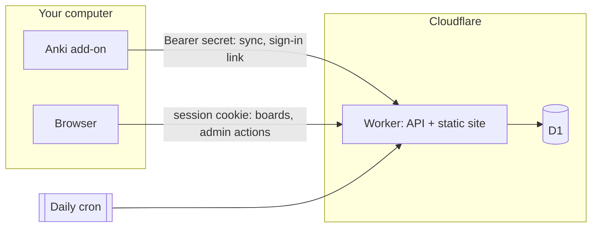

# Architecture

This describes the system as built. For why it is built this way, see the decision records in `docs/adr/`. For what could go wrong, see `docs/threat-model.md`. To run or deploy it, see `docs/INSTALL.md`.

## Overview

An Anki Desktop add-on reads how many cards you reviewed today and sends that number to a Cloudflare Worker. The Worker stores one number per user per day in D1 (SQLite) and serves a React dashboard from the same deployment. People form private boards, join them through invite links, and see each other's counts.

## Components

| Part | Where | Notes |
|---|---|---|
| Add-on | `addon/` | Python. `core.py` holds all logic with no Anki imports so it can be tested alone. `anki_adapter.py` is the only module that touches Anki. `__init__.py` wires menus and the `sync_did_finish` hook. |
| Worker API | `src/` | TypeScript on Workers (V8, not Node). `index.ts` is a regex router. `account.ts`, `boards.ts` and `retention.ts` hold the handlers. `auth.ts`, `crypto.ts`, `http.ts`, `ratelimit.ts` and `validate.ts` are shared helpers. |
| Database | `migrations/` | D1 with strict tables and foreign keys that cascade on delete. |
| Dashboard | `web/` | React 19, Vite, Tailwind 4, shadcn-style components. Served by the Worker as static assets with a single-page-app fallback. Only `/api/*` runs Worker code first. |
| Tests | `tests/` | `worker` (real local D1), `web` (jsdom), `addon` (pytest, in-memory SQLite) and `e2e` (Playwright against `wrangler dev`, with a fake Anki client). |

## Identity and sign-in

There are no passwords, emails or third-party logins. The add-on is the identity provider (ADR 0001).

1. After the first finished sync, the add-on creates a random 256-bit secret and stores it in the collection config, which AnkiWeb syncs between your computers. It only does this if no secret exists yet.
2. The add-on sends the secret as `Authorization: Bearer <secret>`. The server stores only its SHA-256 hash.
3. To open the website, the add-on asks for a one-time login token (128 bits, valid 120 seconds, single use, stored hashed) and opens `<server>/signin#<token>`. The token is in the URL fragment, so it never reaches a server log or a Referer header. The page moves it into memory, clears the address bar, and asks "Sign in as <name>?" before consuming it.
4. Consuming the token sets the cookie `__Host-session` (`HttpOnly; Secure; SameSite=Strict`). The server keeps only a hash of the session id. A session lasts 30 days from last use, extended at most hourly, with a 90-day absolute maximum.
5. Cookie-authenticated requests that change data must carry an `Origin` header equal to the site's own origin. Add-on requests use the Bearer secret and no cookies, so they need no CSRF check.

## Data model

All times are Unix milliseconds. Dates are `YYYY-MM-DD` text. Every token is stored as a hash.

| Table | Purpose |
|---|---|
| `users` | `id` (random 128-bit hex), `secret_hash`, `display_name`, `created_at`, `last_active_date`, `last_push_at` |
| `daily_stats` | One row per `(user_id, local_date)` with `review_count` (0 to 10,000). Upserted with `MAX(existing, new)`. |
| `boards` | `id` (random 128-bit hex), `name`, `invite_enabled`, `invite_epoch`, `member_cap` |
| `memberships` | `(board_id, user_id)` with `role` of `admin` or `member` |
| `login_links` | Hash of a one-time login token, with expiry and `used_at` |
| `sessions` | Hash of a session id, with `created_at` and `expires_at` |
| `rate_limits` | Fixed-window counters keyed by a hash of the limit name and subject, so IP addresses are never stored |

One push serves every board a user is in, because boards read from `daily_stats`.

## Review counts

The add-on counts answers in the local review log since Anki's day cutoff ("next day starts at"), excluding manual and rescheduled entries. That matches Anki's own "Today" figure (ADR 0003). It pushes only today's count, with the user's local date. The server accepts dates within two days of its own UTC date, caps a day at 10,000, and allows one push per user every five minutes. Counts come from the client and can be faked within the cap.

## Boards, invites and roles

- Every board route resolves membership first. A non-member gets the same 404 as a missing board, so nobody can tell whether a board exists. Members who are not admins get 403 on admin routes.
- An invite link is `/join#<boardId>.<token>` where the token is `HMAC-SHA256(INVITE_HMAC_KEY, boardId:epoch)`. It is computed when needed and never stored. Regenerating the link bumps `invite_epoch`, and disabling it turns joining off (ADR 0002).
- Admins are equals. Rules that keep boards manageable (ADR 0004): the last admin cannot leave, be demoted or be removed; any admin can delete the board; deleting needs the exact board name; the daily job repairs any board found with members and no admin.
- The leaderboard query ranks by today, then seven-day total, then name, using a window function. It returns the top 100 plus the caller's own row.

## Abuse limits

Rate limits live in D1 and cost one write per limited request. Every change a signed-in user makes also shares a budget of 200 per hour. The limits are: registration 10 per hour per IP, sign-in link requests 10 per hour per user, link inspect and consume 60 per hour per IP, joins 30 per hour per user and 120 per hour per IP, board creation 20 per day per user, and identity rotation 5 per day per user. Request bodies are capped at 4 KB, display names at 30 characters and board names at 60, a user can be in at most 50 boards, and an admin can set a member limit of up to 1,000,000. That number is only input validation. Viewing a board reads every member and their last seven days (roughly nine rows per member), so boards beyond a few hundred members use the free-tier read budget quickly, and a board of that size would need a different design. Names are Unicode-normalised and reject control, format and bidi characters and angle brackets.

## Scheduled job

A daily cron at 03:17 UTC runs `purge` in `src/retention.ts`: it deletes accounts that never synced or joined a board after 30 days, and accounts inactive for 365 days (at most 25 per run). When it removes a sole admin it promotes the longest-standing active member first, and it deletes boards left empty. It also repairs adminless boards and clears expired links, sessions and old rate-limit rows. Locally it never runs by itself. Trigger it with `curl http://localhost:8787/cdn-cgi/local/scheduled`.

## Security headers

Static assets get a strict Content Security Policy (`default-src 'none'`, scripts and styles from `self` only) and related headers from `web/public/_headers`. API responses are `no-store` with `nosniff` and `no-referrer`. Nothing is rendered as raw HTML.

## Configuration

| Name | Kind | Purpose |
|---|---|---|
| `INVITE_HMAC_KEY` | Worker secret | Signs invite links. At least 32 characters. Never in the repository. |
| `DB` | D1 binding | The database. Its id is in `wrangler.jsonc`. |
| `server_url` | Add-on config | Where the add-on sends data. HTTPS only, except for localhost. |

## Known limitations

- Review capture needs Anki Desktop, because phones cannot run add-ons. Phone reviews count only if the phone and then Anki Desktop sync within the same Anki day, since only today's count is pushed.
- Signing in on a new browser needs Anki Desktop open.
- Counts are client-reported and can be faked within the daily cap.
- Whoever runs a server can read its whole database (display names, board names, counts) through their Cloudflare account.
- The identity secret is visible to AnkiWeb, to backups of the collection and to other add-ons on the machine.
- A person with two AnkiWeb accounts appears as two identities, with no merging.
- Admins are equals with no board owner, so any admin can demote, remove or delete another admin's board, including the creator's.
- Free-tier limits are a hard stop, not a bill, so abuse or growth can make the service fail.

## Not yet verified

- That the collection config really reaches a second computer through AnkiWeb (needs two Anki installs). If it does not, a recovery code is the planned fallback.
- The daily cron. Its schedule registered on the free plan at the first deploy, but the first scheduled run has not been observed yet. Also D1 backup and restore options, and AnkiWeb upload eligibility and multi-factor support for the publishing account.
- The add-on has run only against fakes and a local Worker, never inside a live Anki release.
- The dashboard route (Option B) in `docs/INSTALL.md`. The command-line route (Option A) was run on a live account on 2026-11-23, followed by a smoke test of registration, sync, sign-in, boards, invites and account deletion.

## Open decisions

- Whether to add proof-of-work to registration. Per-IP rate limiting is in place and proof-of-work is not implemented. Recommended: leave it out until abuse is seen.
- Whether to add a Cloudflare-side rate limit in front of the Worker, since each limited request still costs one D1 write.
