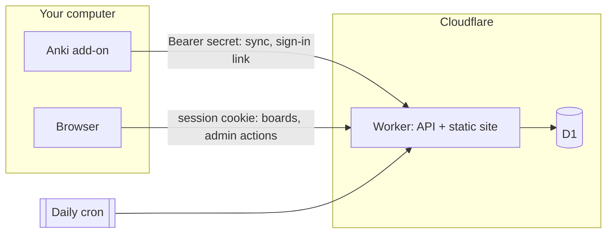

# Architecture

This describes the system as built. For why it is built this way, see the decision records in `docs/adr/`. For what could go wrong, see `docs/threat-model.md`. To run or deploy it, see `docs/INSTALL.md`.

## Overview

An Anki Desktop add-on reads how many cards you reviewed today and sends that number to a Cloudflare Worker. The Worker stores one number per user per day in D1 (SQLite) and serves a React dashboard from the same deployment. People form private boards, join them through invite links, and see each other's counts.

## Components

| Part | Where | Notes |
|---|---|---|
| Add-on | `addon/` | Python. `core.py` holds all logic with no Anki imports so it can be tested alone. `anki_adapter.py` is the only module that touches Anki. `__init__.py` wires menus and the `sync_did_finish` hook. Requests carry a named `User-Agent`, because Cloudflare blocks Python's default one (error 1010), and use Anki's bundled certificate list when present. |
| Worker API | `src/` | TypeScript on Workers (V8, not Node). `index.ts` is a regex router. `account.ts`, `boards.ts` and `retention.ts` hold the handlers. `auth.ts`, `crypto.ts`, `http.ts`, `ratelimit.ts` and `validate.ts` are shared helpers. |
| Database | `migrations/` | D1 with strict tables and foreign keys that cascade on delete. |
| Dashboard | `web/` | React 19, Vite, Tailwind 4, shadcn-style components. Served by the Worker as static assets with a single-page-app fallback. Only `/api/*` runs Worker code first. |
| Tests | `tests/` | `worker` (real local D1), `web` (jsdom), `addon` (pytest, in-memory SQLite) and `e2e` (Playwright against `wrangler dev`, with a fake Anki client). |

## Identity and sign-in

There are no passwords, emails or third-party logins. The add-on is the identity provider (ADR 0001), and each computer has its own key (ADR 0006).

1. The first time you choose Open Leaderboard, the add-on asks "Do you already have a leaderboard account?". If you answer "No, create one" it makes a random 256-bit key and keeps it in a private file in its own `user_files` folder. The key is not in your collection, so Anki's sync never touches it and AnkiWeb never sees it. A sync never creates an identity.
2. The add-on sends the key as `Authorization: Bearer <key>`. The server stores only its SHA-256 hash, one per computer. An account can have up to ten computers.
   - To add a computer, an existing one makes a 12-character code (works once, 10 minutes) and the new one types it in.
   - A computer removed from the account does not quietly register a new one: the add-on discards its key and asks you to set up again.
3. To open the website, the add-on asks for a one-time login token (128 bits, valid 120 seconds, single use, stored hashed) and opens `<server>/signin#<token>`. The token is in the URL fragment, so it never reaches a server log or a Referer header. The page moves it into memory, clears the address bar, and asks "Sign in as <name>?" before consuming it.
4. Consuming the token sets the cookie `__Host-session` (`HttpOnly; Secure; SameSite=Strict`). The server keeps only a hash of the session id. A session lasts 30 days from last use, extended at most hourly, with a 90-day absolute maximum.
5. Cookie-authenticated requests that change data must carry an `Origin` header equal to the site's own origin. Add-on requests use the Bearer secret and no cookies, so they need no CSRF check.

## Data model

All times are Unix milliseconds. Dates are `YYYY-MM-DD` text. Every token is stored as a hash.

| Table | Purpose |
|---|---|
| `users` | `id` (random 128-bit hex), `display_name`, `created_at`, `last_active_date`, `last_push_at`, optionally `recovery_hash` and `recovery_created_at`, and the latest Anki statistics from a push (`stats_date`, `stats_days`, `stats_today_passed`, `stats_today_failed`, `stats_week_passed`, `stats_week_failed`, `stats_retrievability`) |
| `devices` | One row per computer: `user_id`, `secret_hash` (the key's hash), `label`, `created_at`, `last_seen_at` |
| `link_codes` | Hash of a code that adds a computer, with its expiry and `used_at` |
| `daily_stats` | One row per `(user_id, local_date)` with `review_count` (0 to 10,000). Upserted with `MAX(existing, new)`. The daily purge deletes rows older than 10 days, because the board reads at most the last 8. |
| `boards` | `id` (random 128-bit hex), `name`, `invite_enabled`, `invite_epoch`, `member_cap` |
| `board_images` | One optional picture per board: `board_id`, `image` (a JPEG, at most 48 KB) and `version` (when it was set). Separate from `boards` so listing boards never reads image bytes. |
| `memberships` | `(board_id, user_id)` with `role` of `admin` or `member` |
| `login_links` | Hash of a one-time login token, with expiry and `used_at` |
| `sessions` | Hash of a session id, with `created_at` and `expires_at` |
| `rate_limits` | Fixed-window counters keyed by a hash of the limit name and subject, so IP addresses are never stored |

One push serves every board a user is in, because boards read from `daily_stats`.

## Review counts

The add-on counts answers in the local review log since Anki's day cutoff ("next day starts at"), excluding manual and rescheduled entries. That matches Anki's own "Today" figure (ADR 0003). It pushes only today's count, with the user's local date. The server accepts dates within two days of its own UTC date, caps a day at 10,000, and allows one push per user every 30 minutes. Counts come from the client and can be faked within the cap.

Version 1.1 of the add-on also sends a few of Anki's own statistics with each push, read from the backend call behind Anki's Statistics screen (`col._backend.graphs`, over the whole collection, 30 days): days studied in the last 30 (days with any answer), passed and failed review answers today and over 7 days (Anki's "true retention" figures), and Anki's average retrievability, which is only sent when FSRS is on. The call is not a public interface, so if it fails or has a different shape the add-on sends no statistics and the count still goes. The server range-checks them and ignores the whole object if any part is invalid. They are stored on the `users` row that the push already updates, so they cost no extra rows written. The board view returns them per member, leaves out today's retention unless it was sent today, and leaves out all of them when they are more than seven days old. The Stats tab ranks nothing: it charts one chosen statistic for the members the board view returned (the same top 100 as the Today tab, plus the caller).

## Recovery code

A signed-in user can make a recovery code on the Account page (160 random bits, shown once, only its hash stored). If they lose every computer, Tools, Leaderboard Settings, Restore with a recovery code in Anki trades the code for a new key on the same account. It signs out every other computer and session, returns a fresh code, and is single use. See ADR 0005.

## Boards, invites and roles

- Every board route resolves membership first. A non-member gets the same 404 as a missing board, so nobody can tell whether a board exists. Members who are not admins get 403 on admin routes.
- An invite link is `/join#<boardId>.<token>` where the token is `HMAC-SHA256(INVITE_HMAC_KEY, boardId:epoch)`. It is computed when needed and never stored. Regenerating the link bumps `invite_epoch`, and disabling it turns joining off (ADR 0002).
- Admins are equals. Rules that keep boards manageable (ADR 0004): the last admin cannot leave, be demoted or be removed; any admin can delete the board; deleting needs the exact board name; the daily job repairs any board found with members and no admin.
- A board can have a picture (ADR 0007). Admins set it from Board settings: the browser crops and shrinks it to a 192-pixel square JPEG, and the Worker accepts only a JPEG of at most 48 KB. Members fetch it from `/api/boards/<id>/image?v=<version>`; the response is always `image/jpeg` with `nosniff` and a sandbox policy, and is cached for a year because the version in the address changes with the picture. The board lists and board view carry only `image_version`.
- The leaderboard query ranks with a window function and returns the top 100 plus the caller's own row. `?by=today` (the default) ranks by today, then seven-day total, then name. `?by=week` ranks by seven-day total, then today, then name. Any other value is a 400, and only those two fixed orderings ever reach the query. The board page has Today and 7 days tabs, remembers the choice in the browser, and fetches the board again when the tab changes.

## Abuse limits

Rate limits live in D1 and cost one write per limited request. Every change a signed-in user makes also shares a budget of 200 per hour. The limits are: registration 10 per hour per IP, recovery attempts 10 per hour per IP, recovery code creation 5 per day per user, sign-in link requests 10 per hour per user, link inspect and consume 60 per hour per IP, joins 30 per hour per user and 120 per hour per IP, board creation 20 per day per user, and identity rotation 5 per day per user. Request bodies are capped at 4 KB, display names at 30 characters and board names at 60, a user can be in at most 50 boards, and a board holds at most 15,000 members (an admin can set a lower limit, and joins are refused at the ceiling). Viewing a board reads every member and their last seven days (roughly nine rows per member), so one view of a board that size reads about 135,000 rows and the free plan allows about 37 such views a day. A board of that size would need a different design. Names are Unicode-normalised and reject control, format and bidi characters and angle brackets.

## Cost on the free plan

These figures come from reading the code and Cloudflare's published free-plan limits at the time of writing. They have not been measured on the live service. Check the Cloudflare dashboard if usage matters.

- **Limits that matter:** 100,000 D1 rows written and 5 million rows read per day, reset at 00:00 UTC, plus 100,000 Worker requests per day. One D1 database is capped at 500 MB. When a limit is reached, requests fail until the reset. Nothing is billed.
- **Cost of a push:** one request and two rows written (the day's count and the account's last-push time). A push rejected for arriving too soon costs reads only. The add-on does not send when the count is unchanged.
- **Rough capacity:** about 15 writes per active user per day if they push 7 times, which puts the free plan at about 6,600 users active on the same day. Most users push about 3 times, which is about 14,000. Past that, use Cloudflare's paid plan.
- **Why 30 minutes between pushes:** it limits one account (or a looping add-on) to 48 pushes and about 100 writes a day. It does not reduce normal use.
- **Growth:** `daily_stats` has one row per user per active day. The daily job deletes rows older than 10 days, because the board reads at most 8. Board pictures are at most 48 KB each, one per board.
- **Not done on purpose:** caching board views (responses differ per viewer and a cached response still counts as a Worker request), and halving the writes per push. Revisit both if usage approaches the limits above.

## Scheduled job

A daily cron at 03:17 UTC runs `purge` in `src/retention.ts`: it deletes accounts that never synced or joined a board after 30 days, and accounts inactive for 365 days (at most 25 per run). When it removes a sole admin it promotes the longest-standing active member first, and it deletes boards left empty. It also repairs adminless boards and clears expired links, sessions, old rate-limit rows and daily counts older than 10 days. Locally it never runs by itself. Trigger it with `curl http://localhost:8787/cdn-cgi/local/scheduled`.

## Security headers

Static assets get a strict Content Security Policy (`default-src 'none'`, scripts and styles from `self` only) and related headers from `web/public/_headers`. API responses are `no-store` with `nosniff` and `no-referrer`. Nothing is rendered as raw HTML.

## Add-on update notice

The Worker reports the newest add-on version in its reply to a sync (`addon_latest`, from the `ADDON_LATEST_VERSION` setting, empty for self-hosters who do not want it). The add-on compares that with its own version and, if it is older, shows a notice once per release with a link to the Help page on the user's own server. No other site is contacted, so no new party sees anyone's IP address. See `docs/RELEASING.md`.

## Delivery

Every push runs the Worker, web and add-on tests. A push to `main` also runs the browser journeys, and a contract test that runs the real add-on against a local Worker. Only if all of them pass does the workflow deploy, using a Cloudflare API token held as a GitHub secret. Pull requests run the same checks but never receive the secrets. See `docs/INSTALL.md`.

## Configuration

| Name | Kind | Purpose |
|---|---|---|
| `INVITE_HMAC_KEY` | Worker secret | Signs invite links. At least 32 characters. Never in the repository. |
| `DB` | D1 binding | The database. Its id is in `wrangler.jsonc`. |
| `server_url` | Add-on config | Where the add-on sends data. HTTPS only, except for localhost. |

## Known limitations

- Review capture needs Anki Desktop, because phones cannot run add-ons. Phone reviews count only if the phone and then Anki Desktop sync within the same Anki day, since only today's count is pushed.
- Signing in on a new browser needs Anki Desktop open.
- Counts are client-reported and can be faked within the daily cap.
- Whoever runs a server can read its whole database (display names, board names, counts) through their Cloudflare account.
- A computer's key is a plain file readable by anything running as that user, including other add-ons and backups of the Anki folder. It is not sent to AnkiWeb.
- The 30 minute update limit is per account, so two computers on one account share it.
- There is one leaderboard account per computer, not per Anki profile. Profiles on the same computer share one account, appear as one person, and the server keeps the highest of their daily counts. See ADR 0006.
- A person with two AnkiWeb accounts appears as two identities, with no merging.
- Admins are equals with no board owner, so any admin can demote, remove or delete another admin's board, including the creator's.
- Free-tier limits are a hard stop, not a bill, so abuse or growth can make the service fail.

## Not yet verified

- The daily cron. Its schedule registered on the free plan at the first deploy, but the first scheduled run has not been observed yet. Also D1 backup and restore options, and AnkiWeb upload eligibility and multi-factor support for the publishing account.
- The add-on has been run in real Anki Desktop on macOS only. Windows and Linux are untested.
- The statistics (add-on 1.1). They were checked against the `anki` Python package (Anki 26.09.4), including a test that builds real review history and reads it back, but not yet inside a running Anki Desktop, and not on older Anki versions. If an Anki version lacks the fields, members on it show a dash.
- The dashboard route (Option B) in `docs/INSTALL.md`. The command-line route (Option A) was run on a live account on 2026-11-23, followed by a smoke test of registration, sync, sign-in, boards, invites and account deletion.

## Open decisions

- Whether to add proof-of-work to registration. Per-IP rate limiting is in place and proof-of-work is not implemented. Recommended: leave it out until abuse is seen.
- Whether to add a Cloudflare-side rate limit in front of the Worker, since each limited request still costs one D1 write.
