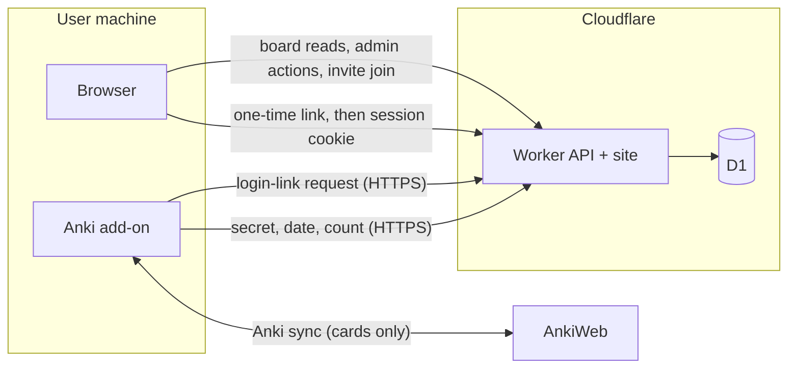

# Threat Model

Status: version 1, updated for the released design. First written 2026-10-24. Method: Shostack's four questions, with STRIDE for question 2. Scope: the system in `docs/ARCHITECTURE.md` and the decisions in `docs/adr/`. Update it whenever authentication, invites or roles change.

## 1. What are we working on?

### Components

- Add-on: Python code running inside the user's Anki Desktop, with full access to their collection.
- Worker: Cloudflare Worker serving the API and the static React front end.
- D1: Cloudflare's SQLite database.
- Browser: the user's web browser.
- AnkiWeb: Anki's own sync service. It is outside our control. Since ADR 0006 it no longer carries any leaderboard credential.

### Data flow

### Trust boundaries

1. The user's machine and Anki profile, including every other installed add-on.
2. The internet, between the user and Cloudflare.
3. The Worker, which is trusted code and the only thing that touches D1.
4. AnkiWeb, a third party. It holds no leaderboard credential.

### Assets

| Asset | Why it matters |
|---|---|
| Identity secret | Whoever holds it is that user, including as board admin. |
| Login links and session cookies | Grant website access as that user. |
| Server HMAC key | Forges invite links for every board. |
| Board membership and roles | Privacy of private boards and admin control. |
| Review counts, display names | Low sensitivity, but personal data under UK GDPR. |
| Add-on distribution account | A malicious update would run inside every user's Anki. |
| Free-tier budget | Exhaustion causes an outage. |

### Actors

Board member, non-member, holder of a leaked invite link, malicious or compromised add-on on a user's machine, scripted abuser of the API, anyone who reads the database, and a compromised dependency or publishing account.

## 2. What can go wrong?

STRIDE: Spoofing, Tampering, Repudiation, Information disclosure, Denial of service, Elevation of privilege.

| ID | Where | Threat | STRIDE |
|---|---|---|---|
| T1 | Identity secret | Secret stolen from AnkiWeb, a collection backup, another add-on, logs, or traffic, then used to impersonate the user or their admin role. | S, E |
| T2 | Sync | Forged or inflated review counts. | T |
| T3 | Registration and sync | Scripted flood of registrations or syncs exhausts the free-tier budget. | D |
| T4 | Login link | Link intercepted, replayed or guessed. | S |
| T5 | Login link | Victim opens an attacker's link and is signed in as the attacker (login CSRF). | S |
| T6 | Login link | Link leaks via browser history, referrer or logs. | I |
| T7 | Session | Cookie stolen through XSS, for example via a display name. | S, I |
| T8 | Session | Cross-site request forges an admin action such as kick or regenerate (CSRF). | T, E |
| T9 | Board API | Missing or wrong membership check lets a non-member read a board, or a member perform admin actions (IDOR). | I, E |
| T10 | Board API | Response reveals whether a board exists. | I |
| T11 | Board API | Kicked member keeps access through an old session or cached data. | E |
| T12 | Memberships | Concurrent demote or leave leaves a board with no admin. | T, D |
| T13 | Invite link | A leaked link lets strangers join a board. | I, E |
| T14 | Invite link | Disabled or regenerated links keep working. | E |
| T15 | Server HMAC key | Key leak or rotation: leak forges invites for all boards, rotation breaks all links. | E, D |
| T16 | D1 | Database leak, or injection through unparameterised queries. | I, T |
| T17 | Identity sync | AnkiWeb config sync overwrites the secret, or a second secret is created on another laptop. (Replaced by ADR 0006: the key is no longer in synced data.) | T, D |
| T34 | Link code | Someone guesses a link code and adds their computer to another person's account. | S, E |
| T35 | Link code | A code works twice, after it expires, or after a newer one replaces it. | E |
| T36 | Add-on | A computer the server has forgotten (for example one removed from the account) quietly registers a new account. | T |
| T37 | Computers | A user removes another account's computer, or removes the last one and is locked out. | E, D |
| T38 | Board picture | A member or outsider sets, replaces or removes a board's picture, or reads it without being a member. | T, I |
| T39 | Board picture | An upload that is not a picture (script, HTML, a very large file) is stored and later run in someone's browser, or used to fill the database. | T, E, D |
| T18 | Add-on distribution | Compromised publishing account ships a malicious add-on update. | E |
| T19 | Dependencies | Malicious or vulnerable package in the Worker, front end or vendored add-on code. | T, E |
| T20 | Platform | Free-tier limits reached, so the service fails closed. | D |
| T21 | Personal data | Display names retained too long, or no way to delete them. | I |
| T22 | Logs | Secrets or tokens written to logs. | I |
| T23 | Add-on | The add-on trusts a server response in a way that runs attacker-controlled code on the user's machine. | E |
| T24 | Add-on | A redirect from the server (hostile or misconfigured) makes the add-on forward its Authorization header, the identity secret, to another address, possibly over plain http. | I |
| T25 | Server HMAC key | A missing, empty or short `INVITE_HMAC_KEY` makes invite links guessable or forgeable. | E |
| T26 | Worker | An oversized request body is buffered whole into memory before it is rejected. | D |
| T27 | Names | Stacked combining marks ("zalgo" text) in a display or board name break the layout for other members. | T |
| T28 | Add-on | The default display name, taken from the Anki profile name, is refused by the server, so registration fails with no explanation. | D |
| T29 | Worker | One signed-in account spams changes (renames, role changes and so on) to burn the free-tier write quota. | D |
| T30 | Recovery code | Someone guesses a recovery code and takes over an account. | S, E |
| T31 | Recovery code | A used or replaced recovery code still works, or two attempts both succeed. | E |
| T32 | Recovery code | The code is stored or logged in a form that can be read back, or leaks through a response. | I |
| T33 | Recovery code | Restoring leaves the old secret or old browser sessions working. | E |

## 3. What are we going to do about it?

| ID | Mitigation | Reference | Test |
|---|---|---|---|
| T1 | Store only a hash server-side. Never log secrets. Provide Reset this computer's key (Leaderboard Settings) to rotate the secret. Use HTTPS only. Accept residual exposure via AnkiWeb and other add-ons. | Design | Rotated secret stops working. Only hashes stored. |
| T2 | Sanity cap of 10,000 reviews per day, 30-minute push interval, and the `MAX` upsert. Spoofing within the cap is accepted. | Design | Over-cap rejected. Upsert keeps the maximum. |
| T3 | Rate limits on register, sync, link creation and join. Purge never-activated identities after 30 days. Outage on exhaustion is accepted. | Design | Rate limits trigger. Purge removes only the right rows. |
| T4 | 128-bit random link, valid about two minutes, single use, stored as a hash. | Design | Expired and reused links rejected. |
| T5 | The landing page shows an interstitial naming the account ("Sign in as <display name>?"), and the UI always shows who is signed in. If a session for another account already exists, ask before switching. Residual impact is low. | Design | Interstitial shown before a session is created. |
| T6 | Single use and short expiry make a leaked link useless. | Design | Used link rejected. |
| T7 | `HttpOnly`, `Secure`, `SameSite` cookies. No raw HTML rendering, a strict CSP, and limits on display names. | Design | CSP header present. Names are escaped. |
| T8 | `SameSite`, state-changing actions use non-GET methods only, and an `Origin` check. | Design | Cross-origin admin request rejected. |
| T9 | Membership and role check on every board endpoint. | Design | Authorisation matrix: non-member, member, admin on every route. |
| T10 | Non-members get a not-found response. | Design | Non-member response equals a missing board. |
| T11 | Check membership on every request, never cache board data publicly. | Design | Kicked member rejected immediately. |
| T12 | Last admin cannot leave, demote or be removed without promoting someone, each enforced in one SQL statement. The daily purge repairs any board found with members and no admin. | Design | Concurrent demotion and mutual-removal tests, repair test. |
| T13 | Admin can disable or regenerate the link, and optionally set a member cap. Rate-limit joins. | Design | Disabled and regenerated links rejected. |
| T14 | Token is `HMAC(server_secret, board_id + invite_epoch)`. Regenerating bumps the epoch. | Design | Old epoch rejected. |
| T15 | Keep the key as a Worker secret, separate per environment, never in D1 or the repo. Use random 128-bit board IDs so a leaked key alone cannot forge a link without also knowing the board ID. Rotation is a single key replacement that invalidates all outstanding invite links, which members re-copy from the board page. | Design | A token made with another key is rejected. Board IDs are non-sequential. |
| T16 | Hashes only, parameterised queries throughout, no plaintext tokens. | Design | No string-built SQL in review. |
| T17 | Obsolete: the key lives in a private file outside the synced collection, and a sync never creates an identity. | ADR 0006 | `a sync never creates an identity` in `tests/addon/test_core.py`. |
| T34 | 60-bit codes, 10 attempts an hour per address, 5 codes an hour per account, ten-minute lifetime, and every bad code gets the same answer. | src/account.ts | `answers every bad code the same way` and `limits attempts per address and codes per user` in `tests/worker/devices.test.ts`. |
| T35 | One UPDATE uses the code up. A new code deletes the older ones. | src/account.ts | `works once, even if two computers try at the same moment` and `expires after ten minutes` in `tests/worker/devices.test.ts`. |
| T36 | The add-on remembers the server has accepted it, and discards its key instead of registering again. | addon/core.py | `TestRemovedComputer` in `tests/addon/test_core.py`, and the contract test. |
| T37 | Removal needs a signed-in same-origin request, only touches the caller's own computers (others look like missing ones), and refuses to remove the last. | src/account.ts | `will not touch another account's computers` and `never removes the last computer` in `tests/worker/devices.test.ts`. |
| T38 | Setting and removing need an admin, and reading needs membership. Everyone else gets the same 404 as a missing board. | src/boards.ts | The board authorisation matrix in `tests/worker/boards.test.ts`, and `is admin only` in `tests/worker/picture.test.ts`. |
| T39 | Only a JPEG of 100 bytes to 48 KB is accepted: the content type and the start and end markers are checked, and the body is read as a stream with that cap. It is always served as `image/jpeg` with `nosniff` and `Content-Security-Policy: sandbox`, so it is never run. The browser re-encodes the picture, which also drops its metadata, but the server does not rely on that. Writes share the 200 an hour budget (T29). | src/boards.ts, src/http.ts | `rejects anything that is not a small JPEG` and `serves the bytes to members only` in `tests/worker/picture.test.ts`. |
| T18 | The project owner publishes the add-on. Protect the AnkiWeb publishing account with a unique strong password in a password manager, and with MFA if AnkiWeb offers it (to verify). Keep the source public and the add-on small, publish from tagged commits, and review each release against a checklist. | To specify | Release checklist. |
| T19 | Minimise dependencies, pin versions, run dependency audits in CI. | Design | CI audit step. |
| T20 | Accepted. Add-on retries later. | Design | Retry and dedupe test. |
| T21 | Account deletion, retention rules (30 days, 12 months, and daily counts kept for 10 days), and a privacy policy stating them. | Design | Delete removes all rows. |
| T22 | Never log request bodies, secrets or tokens. | Design | Log review. |
| T23 | Treat server responses as untrusted data: parse JSON only, validate fields, never evaluate or download code, and verify TLS certificates. | Design | Add-on test with malformed and hostile responses. |
| T24 | The add-on never follows redirects; any redirect is an error. | addon/core.py | `TestRedirects`: a 302 is refused and the secret never reaches the target. |
| T25 | The Worker refuses to sign or verify invites unless the key is at least 32 characters, returning a 500 instead. | src/crypto.ts | `invite key` test in `tests/worker/hardening.test.ts`. |
| T26 | Bodies are read as a stream with a 4 KB cap and a Content-Length pre-check. | src/http.ts | `request bodies` test in `tests/worker/hardening.test.ts`. |
| T27 | Names reject four or more combining marks in a row, on top of the existing length, control, bidi and angle-bracket rules. | src/validate.ts | `input protections` test in `tests/worker/identity.test.ts`. |
| T28 | The add-on cleans the profile name with the same rules before sending it, falling back to "Anki user". | addon/core.py | `TestDefaultDisplayName`. |
| T29 | Every change by a signed-in user shares a budget of 200 per hour. | src/auth.ts | `input protections` test in `tests/worker/identity.test.ts`. |
| T30 | Codes carry 160 random bits, restoring is limited to 10 attempts an hour per address, and every wrong, malformed or used code gets the same answer. | src/account.ts | `answers every bad code the same way` and `is rate limited per address` in `tests/worker/recovery.test.ts`. |
| T31 | One UPDATE swaps the code and the secret together, so a code works once. Replacing a code cancels the old one. | src/account.ts | `lets only one of two simultaneous attempts win`, `is single use`, `replaces the earlier code`. |
| T32 | Only a SHA-256 hash is stored. The code is returned once, never by `/api/me`, and never logged. | src/account.ts | `returns a 160-bit code once and stores only its hash`. |
| T33 | Restoring deletes every session and sign-in link for the account and replaces the secret hash. | src/account.ts | `moves the account to a new secret and keeps its boards`. |

### Accepted risks

- Counts within the cap can be faked.
- A computer's key is a file readable by anything running as that user, including other add-ons and backups of the Anki folder. It is not exposed to AnkiWeb or in collection backups.
- The service can fail when free-tier limits are reached.
- A person with two AnkiWeb accounts appears as two identities.
- Admins are equals with no board owner: a promoted admin can demote, remove or delete the board of the creator or any other admin (elevation within a board, T9 and T12 only cover non-admins and the last admin). Board deletion is guarded by admin-only access, an exact-name confirmation and the same-origin check, and is in the authorisation matrix.

## 4. Did we do a good job?

- Rows that name a test (T24 onward) point at tests that run in CI. Earlier rows (T1 to T23) describe the mitigation and the kind of check, and some of those checks, such as log review and the release checklist, are done by hand rather than automatically.
- A mitigation without a test is not done. Add the test when you change the row.
- Assumptions that could invalidate the model:
  - Anki keeps the add-on's `user_files` folder when an add-on is updated (ADR 0006). This held for the update from 0.3.0 to 0.3.1 on a real Anki install.
  - The `sync_did_finish` hook and safe `revlog` access behave as expected.
  - Cloudflare features used (cron triggers, D1 backup options) are available on the free plan.
- Open design items: T18 release process, and whether AnkiWeb offers MFA for the publishing account.
- Review points: after the first build, before launch, and after any change to authentication, invites or roles. Use the `/code-review` and `/security-review` skills as a first pass, followed by a human read of the authorisation code.
- Add new threats to the table when found. Keep IDs stable.
