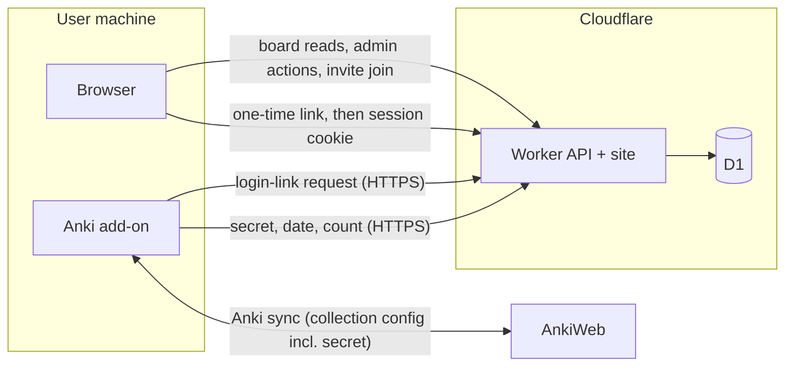

# Threat Model

Status: Draft v1, design stage. Date: 2026-10-24. Method: Shostack's four questions, with STRIDE for question 2. Scope: the design in `docs/PRD.md` and `docs/adr/0001-identity-and-authentication.md`. Revisit after the first build and before launch.

## 1. What are we working on?

### Components

- Add-on: Python code running inside the user's Anki Desktop, with full access to their collection.
- Worker: Cloudflare Worker serving the API and the static React front end.
- D1: Cloudflare's SQLite database.
- Browser: the user's web browser.
- AnkiWeb: Anki's own sync service. It is outside our control and carries the identity secret inside the collection config.

### Data flow

### Trust boundaries

1. The user's machine and Anki profile, including every other installed add-on.
2. The internet, between the user and Cloudflare.
3. The Worker, which is trusted code and the only thing that touches D1.
4. AnkiWeb, a third party that holds a copy of the secret.

### Assets

| Asset | Why it matters |
|---|---|
| Identity secret | Whoever holds it is that user, including as board admin. |
| Login links and session cookies | Grant website access as that user. |
| Server HMAC key | Forges invite links for every board. |
| Board membership and roles | Privacy of private boards and admin control. |
| Review counts, display names | Low sensitivity, but personal data under UK GDPR. |
| Add-on distribution account | A malicious update would run inside every user's Anki. |
| Free-tier budget | Exhaustion causes an outage. |

### Actors

Board member, non-member, holder of a leaked invite link, malicious or compromised add-on on a user's machine, scripted abuser of the API, anyone who reads the database, and a compromised dependency or publishing account.

## 2. What can go wrong?

STRIDE: Spoofing, Tampering, Repudiation, Information disclosure, Denial of service, Elevation of privilege.

| ID | Where | Threat | STRIDE |
|---|---|---|---|
| T1 | Identity secret | Secret stolen from AnkiWeb, a collection backup, another add-on, logs, or traffic, then used to impersonate the user or their admin role. | S, E |
| T2 | Sync | Forged or inflated review counts. | T |
| T3 | Registration and sync | Scripted flood of registrations or syncs exhausts the free-tier budget. | D |
| T4 | Login link | Link intercepted, replayed or guessed. | S |
| T5 | Login link | Victim opens an attacker's link and is signed in as the attacker (login CSRF). | S |
| T6 | Login link | Link leaks via browser history, referrer or logs. | I |
| T7 | Session | Cookie stolen through XSS, for example via a display name. | S, I |
| T8 | Session | Cross-site request forges an admin action such as kick or regenerate (CSRF). | T, E |
| T9 | Board API | Missing or wrong membership check lets a non-member read a board, or a member perform admin actions (IDOR). | I, E |
| T10 | Board API | Response reveals whether a board exists. | I |
| T11 | Board API | Kicked member keeps access through an old session or cached data. | E |
| T12 | Memberships | Concurrent demote or leave leaves a board with no admin. | T, D |
| T13 | Invite link | A leaked link lets strangers join a board. | I, E |
| T14 | Invite link | Disabled or regenerated links keep working. | E |
| T15 | Server HMAC key | Key leak or rotation: leak forges invites for all boards, rotation breaks all links. | E, D |
| T16 | D1 | Database leak, or injection through unparameterised queries. | I, T |
| T17 | Identity sync | AnkiWeb config sync overwrites the secret, or a second secret is created on another laptop. | T, D |
| T18 | Add-on distribution | Compromised publishing account ships a malicious add-on update. | E |
| T19 | Dependencies | Malicious or vulnerable package in the Worker, front end or vendored add-on code. | T, E |
| T20 | Platform | Free-tier limits reached, so the service fails closed. | D |
| T21 | Personal data | Display names retained too long, or no way to delete them. | I |
| T22 | Logs | Secrets or tokens written to logs. | I |
| T23 | Add-on | The add-on trusts a server response in a way that runs attacker-controlled code on the user's machine. | E |
| T24 | Add-on | A redirect from the server (hostile or misconfigured) makes the add-on forward its Authorization header, the identity secret, to another address, possibly over plain http. | I |
| T25 | Server HMAC key | A missing, empty or short `INVITE_HMAC_KEY` makes invite links guessable or forgeable. | E |
| T26 | Worker | An oversized request body is buffered whole into memory before it is rejected. | D |

## 3. What are we going to do about it?

| ID | Mitigation | Reference | Test |
|---|---|---|---|
| T1 | Store only a hash server-side. Never log secrets. Provide Reset Leaderboard Identity to rotate the secret. Use HTTPS only. Accept residual exposure via AnkiWeb and other add-ons. | PRD 5, 6, 10 | Rotated secret stops working. Only hashes stored. |
| T2 | Sanity cap of 10,000 reviews per day, 5-minute push interval, and the `MAX` upsert. Spoofing within the cap is accepted. | PRD 6, 7, 10 | Over-cap rejected. Upsert keeps the maximum. |
| T3 | Rate limits on register, sync, link creation and join. Purge never-activated identities after 30 days. Outage on exhaustion is accepted. | PRD 10, 12 | Rate limits trigger. Purge removes only the right rows. |
| T4 | 128-bit random link, valid about two minutes, single use, stored as a hash. | PRD 5, 7 | Expired and reused links rejected. |
| T5 | The landing page shows an interstitial naming the account ("Sign in as <display name>?"), and the UI always shows who is signed in. If a session for another account already exists, ask before switching. Residual impact is low. | PRD 5, 9 | Interstitial shown before a session is created. |
| T6 | Single use and short expiry make a leaked link useless. | PRD 5 | Used link rejected. |
| T7 | `HttpOnly`, `Secure`, `SameSite` cookies. No raw HTML rendering, a strict CSP, and limits on display names. | PRD 5, 10 | CSP header present. Names are escaped. |
| T8 | `SameSite`, state-changing actions use non-GET methods only, and an `Origin` check. | PRD 10 | Cross-origin admin request rejected. |
| T9 | Membership and role check on every board endpoint. | PRD 8, 10 | Authorisation matrix: non-member, member, admin on every route. |
| T10 | Non-members get a not-found response. | PRD 8 | Non-member response equals a missing board. |
| T11 | Check membership on every request, never cache board data publicly. | PRD 8, 9 | Kicked member rejected immediately. |
| T12 | Last admin cannot leave, demote or be removed without promoting someone, each enforced in one SQL statement. The daily purge repairs any board found with members and no admin. | PRD 8 | Concurrent demotion and mutual-removal tests, repair test. |
| T13 | Admin can disable or regenerate the link, and optionally set a member cap. Rate-limit joins. | PRD 8 | Disabled and regenerated links rejected. |
| T14 | Token is `HMAC(server_secret, board_id + invite_epoch)`. Regenerating bumps the epoch. | PRD 8 | Old epoch rejected. |
| T15 | Keep the key as a Worker secret, separate per environment, never in D1 or the repo. Use random 128-bit board IDs so a leaked key alone cannot forge a link without also knowing the board ID. Rotation is a single key replacement that invalidates all outstanding invite links, which members re-copy from the board page. | PRD 7, 8 | A token made with another key is rejected. Board IDs are non-sequential. |
| T16 | Hashes only, parameterised queries throughout, no plaintext tokens. | PRD 7 | No string-built SQL in review. |
| T17 | Create the secret only after a sync finishes and only if none exists. Adopt the synced one. Fall back to a recovery code if config does not sync. | ADR 0001, PRD 5 | Add-on logic test with a faked adapter. |
| T18 | The project owner publishes the add-on. Protect the AnkiWeb publishing account with a unique strong password in a password manager, and with MFA if AnkiWeb offers it (to verify). Keep the source public and the add-on small, publish from tagged commits, and review each release against a checklist. | To specify | Release checklist. |
| T19 | Minimise dependencies, pin versions, run dependency audits in CI. | PRD 13 | CI audit step. |
| T20 | Accepted. Add-on retries later. | PRD 12 | Retry and dedupe test. |
| T21 | Account deletion, retention rules (30 days and 12 months), and a privacy policy stating them. | PRD 10 | Delete removes all rows. |
| T22 | Never log request bodies, secrets or tokens. | PRD 10 | Log review. |
| T23 | Treat server responses as untrusted data: parse JSON only, validate fields, never evaluate or download code, and verify TLS certificates. | PRD 6 | Add-on test with malformed and hostile responses. |
| T24 | The add-on never follows redirects; any redirect is an error. | addon/core.py | `TestRedirects`: a 302 is refused and the secret never reaches the target. |
| T25 | The Worker refuses to sign or verify invites unless the key is at least 32 characters, returning a 500 instead. | src/crypto.ts | `invite key` test in `tests/worker/hardening.test.ts`. |
| T26 | Bodies are read as a stream with a 4 KB cap and a Content-Length pre-check. | src/http.ts | `request bodies` test in `tests/worker/hardening.test.ts`. |

### Accepted risks

- Counts within the cap can be faked.
- The secret is exposed to AnkiWeb, to any holder of the collection or a backup, and to other add-ons.
- The service can fail when free-tier limits are reached.
- A person with two AnkiWeb accounts appears as two identities.
- Admins are equals with no board owner: a promoted admin can demote, remove or delete the board of the creator or any other admin (elevation within a board, T9 and T12 only cover non-admins and the last admin). Board deletion is guarded by admin-only access, an exact-name confirmation and the same-origin check, and is in the authorisation matrix.

## 4. Did we do a good job?

- This model is a design-stage draft. Nothing is built, so every mitigation is unverified.
- Before launch, check each row above against the code and its named test. A mitigation without a test is not done.
- Assumptions that could invalidate the model:
  - Collection config syncs through AnkiWeb.
  - The `sync_did_finish` hook and safe `revlog` access behave as expected.
  - Cloudflare features used (cron triggers, D1 backup options) are available on the free plan.
- Open design items: T18 release process, and whether AnkiWeb offers MFA for the publishing account.
- Review points: after the first build, before launch, and after any change to authentication, invites or roles. Use the `/code-review` and `/security-review` skills as a first pass, followed by a human read of the authorisation code.
- Add new threats to the table when found. Keep IDs stable.
